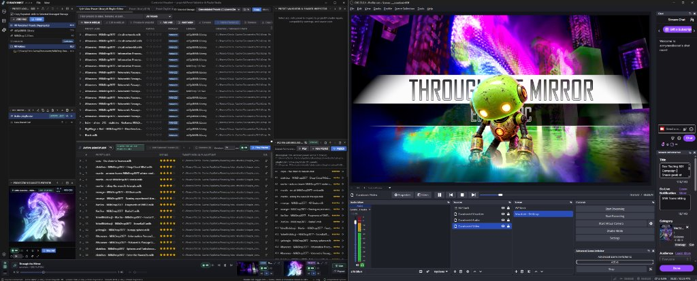
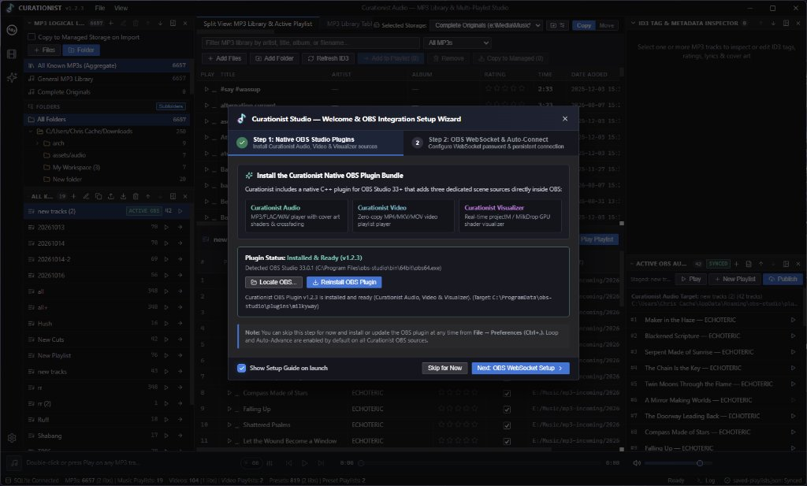
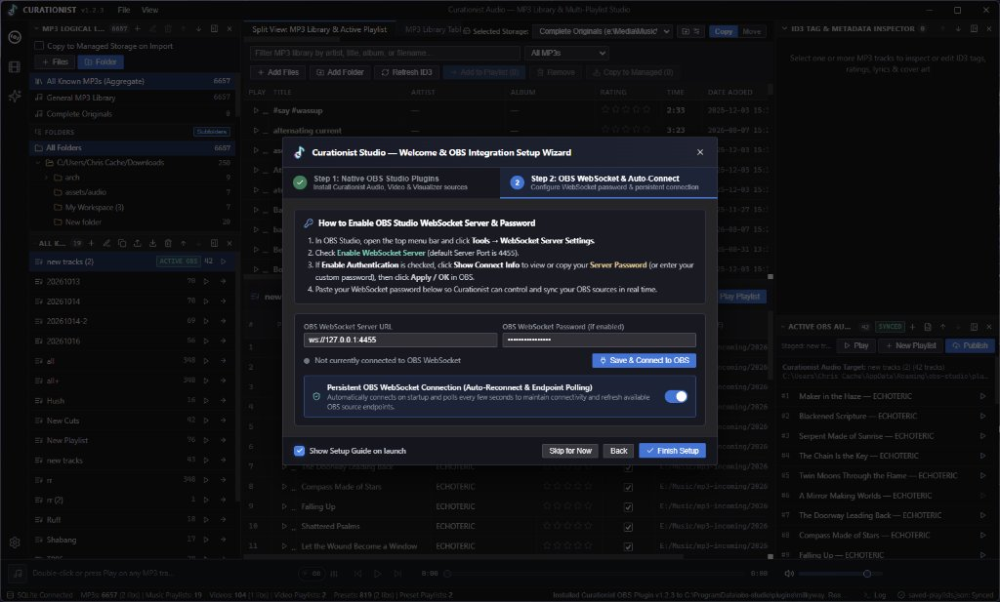

# Curationist

**A desktop media curation studio and native OBS Studio 33+ plugin suite for live audio playlists, zero-copy video loops, and audio-reactive projectM / MilkDrop GPU visualizers.**

[](https://github.com/obcache/curationist/releases)
[](#system-requirements)
[](#native-obs-studio-sources)
[](https://sorryneedboost.com)



---

## Overview

**Curationist** brings your entire live-stream music, video loop, and MilkDrop visualizer workflow into one fast, dense, VS Code-styled desktop studio—paired directly with a **native C++ OBS Studio plugin** installed in one click.

Instead of juggling external media players, fragile browser sources, and scattered folders, Curationist lets you organize thousands of audio tracks, video clips, and `.milk` shader presets in local SQLite-backed libraries, preview everything locally, publish playlists atomically to OBS, and take live broadcast control over OBS WebSocket v5 from a unified control deck or fullscreen **Performance Mode**.

### What's Included in One Installer

1. **Curationist Desktop Studio** — Three dedicated curation workspaces (`Audio`, `Video`, `Visualizer`) plus a persistent **Universal Control Surface** with detachable popout windows and fullscreen Performance Mode.
2. **Native C++ OBS Studio Plugin Bundle** (`Curationist Audio`, `Curationist Video`, `Curationist Visualizer`) — Installed directly into `%ProgramData%\obs-studio\plugins\milkyway` via the built-in Setup Wizard.
3. **Bundled `milkLab` Preset IDE** — A built-in MilkDrop `.milk` preset editor with live projectM equation linting and automatic two-way library sync.

---

## What's New in v1.2.4

> *This section serves as the release notes for **v1.2.4** (`Curationist-1.2.4-win11-x64.exe`).*

- **Guided 2-Step Welcome & OBS Setup Wizard** — Detects your OBS Studio 33+ installation, installs or updates the native C++ plugin bundle in one click (with automatic SHA-256 update checks), and walks you through OBS WebSocket authentication and persistent auto-connect.
- **Native `Curationist Video` Source & Video Workspace (`Ctrl+2`)** — Full video clip library management, folder-tree filtering, star ratings, multi-playlist staging, local preview shuttle, and zero-copy OBS video playback (`MP4`, `MKV`, `WEBM`, `MOV`, `AVI`, `M4V`).
- **Configurable Audio & Video Crossfade / Auto-Fade (`-15s` to `+15s`)** — Choose `0s` for standard cuts, positive `+1s` to `+15s` for overlapping audio crossfades / GPU video cross-dissolves, or negative `-1s` to `-15s` for sequential fade-out → fade-in transitions with no overlap.
- **Advance on Song Change Sync** — Automatically transition `Curationist Video` clips and `Curationist Visualizer` presets whenever `Curationist Audio` advances to the next track.
- **Universal Control Surface, Master OB Toggle & Performance Mode (`Live`)** — Control Audio, Video, and Visualizer channels simultaneously from the bottom deck, arm/disarm all three OBS remote channels at once with the 3-position **Master OB Toggle**, detach monitors or the entire control deck into standalone popout windows, or launch fullscreen **Performance Mode**.
- **Bundled `milkLab` Preset IDE (`Ctrl+N` / `Ctrl+E`)** — Create new `.milk` presets or edit existing library presets with real-time projectM equation diagnostics and instant save-back into Curationist's library.
- **Persistent OBS WebSocket v5 Auto-Connect** — Automatically reconnects on startup, polls every 3 seconds to discover new or recreated OBS sources, self-heals source bindings, and defaults Loop & Auto-Advance on newly discovered sources.
- **Customizable Table Columns & Dockable Panels** — Drag to reorder or resize table columns, rearrange or collapse dockable sidebar sections, and reset layouts anytime from `View`.

---

## Native OBS Studio Sources

The bundled C++ OBS plugin adds three dedicated sources to OBS Studio's **Add Source (`+`)** menu:

| OBS Source | Purpose | Key Capabilities |
| :--- | :--- | :--- |
| **Curationist Audio** | Native audio playlist & album art player | Plays `MP3`, `FLAC`, `WAV`, `M4A`, `AIFF` (plus `OGG`, `OPUS`, `AAC`, `WMA`) with live GPU cover-art shaders (**Brightness, Contrast, Saturation, Glow Size/Intensity/Color, Vignette Strength/Roundness, Audio Bounce, Camera Shake**), Loop, Shuffle, and **-15s to +15s Crossfade / Auto-Fade**. |
| **Curationist Video** | Zero-copy video playlist player | Plays `MP4`, `MKV`, `WEBM`, `MOV`, `AVI`, `M4V` queues with **-15s to +15s GPU Cross-Dissolve / Auto-Fade**, Loop, Shuffle, and **Advance on Song Change** sync. |
| **Curationist Visualizer** | Real-time projectM / MilkDrop GPU visualizer | Renders `.milk` shader playlists driven by **any OBS audio source or scene mix** (or time-driven silence mode), up to **1920×1080 @ 10–60 FPS**, with configurable **Soft-Cut Transition (0–30,000 ms)**, preset hold interval, Auto-Advance, Loop, Shuffle, and **Advance on Song Change**. |

---

## Core Features

### 1. Curationist Audio Workspace (`Ctrl+1`)
- **High-Capacity Libraries**: Organize thousands of tracks across multiple logical libraries or browse your entire aggregate catalog with virtualized tables, instant text search, star-rating filters, and a collapsible recursive **Folder Tree Filter**.
- **Full ID3 Tag & Metadata Inspector**: Inspect and batch-edit Title, Artist, Album, Year, Genre, Track #, Comment, 5-star ratings (POPM / star tags), embedded cover art, and both unsynced and synced (`.lrc` / SYLT) lyrics.
- **Multi-Playlist Staging & Publishing**: Drag and drop tracks to reorder playlists, queue tracks to OBS with **Play Now**, **Play Next**, **Append**, or **Publish**, copy/move curated assets into Managed Storage folders, and export single playlists or `saved-playlists.json` (`nowPlaylisting` compatible).

### 2. Curationist Video Workspace (`Ctrl+2`)
- **Video Clip Libraries & Playlists**: Import folders or individual clips (`MP4`, `MKV`, `WEBM`, `MOV`, `AVI`, `M4V`), rate clips with 5-star ratings, filter by folder hierarchy, and build reusable scene playlists.
- **Built-In Preview & Live OBS Mirroring**: Preview clips locally or flip the **OB** toggle to mirror and scrub the active `Curationist Video` OBS source in real time.
- **Remote Mode & Crossfade Controls**: Adjust Loop, Shuffle, Advance on Song Change, and GPU cross-dissolve timing directly from Curationist without digging into OBS properties.

### 3. Curationist Visualizer Workspace (`Ctrl+3`) & `milkLab` Preset IDE
- **Automatic Preset Validation & Repair**: When importing `.milk` files, Curationist inspects and repairs common shader/syntax issues for **projectM v4**, tagging presets with clear `VALIDATED`, `REPAIRED`, or warning badges and displaying full shader source & repair details in the **Preset Validator & Shader Inspector**.
- **Embedded Native projectM v4 Live Preview**: Audition presets in real time inside the workspace via Curationist's bundled native projectM host (`projectM-4.dll`), or point the preview to mirror your live OBS visualizer.
- **Bundled `milkLab` Preset IDE (`Ctrl+N` / `Ctrl+E`)**: Launch a dedicated preset authoring environment with starter templates, live projectM equation linting, and automatic sync back into Curationist's SQLite database and managed preset folders.
- **Legacy Compatibility**: Supports importing and publishing `obSpiltMilk` `library.json` and `playlist.dat` files alongside native OBS queue publishing.

### 4. Universal Control Surface, Master OB Toggle & Performance Mode
- **Always-On Transport Deck**: The persistent bottom bar keeps **Audio Shuttle** (with clickable track titles that jump straight to the song in your library), **Live Video Preview**, and **Live projectM Preset Preview** accessible from every workspace.
- **Independent `OB` Remote Toggles & 3-Position Master OB Toggle**: Click `OB` on Audio, Video, or Visualizer to switch that channel from local auditioning to live OBS WebSocket control (automatically muting local preview so audio never doubles). Flip the far-left **Master OB Toggle** (`ON` / `MIXED` / `OFF`) to arm or disarm all three channels simultaneously.
- **Live Performance Mode & Detachable Popouts**: Click **Live** to open a clean fullscreen broadcast command center with dual large Video + Visualizer monitors and Audio transport—or click **Popout** to detach the control deck (or individual preview monitors) onto a second screen without interrupting playback.

---

## Quick Start & OBS Setup

### Step 1: Install Curationist
1. Download **`Curationist-1.2.4-win11-x64.exe`** from the [Releases](https://github.com/obcache/curationist/releases) page.
2. Run the installer and launch **Curationist**.

### Step 2: Install the Native OBS Studio Plugin
On first launch, the **Welcome & OBS Integration Setup Wizard** opens automatically (you can reopen it anytime via `File → OBS Setup & Connection Wizard...`).



1. Verify that your **OBS Studio 33+** installation is detected (or click **Locate OBS...** to select `obs64.exe` if installed in a custom location).
2. Click **Install OBS Plugin Now** to install the native C++ bundle into `%ProgramData%\obs-studio\plugins\milkyway`.
3. Restart **OBS Studio** so OBS loads the three new scene sources.

### Step 3: Enable & Connect OBS WebSocket
Click **Next: OBS WebSocket Setup** inside the wizard:



1. In OBS Studio, open **`Tools → WebSocket Server Settings`**.
2. Check **Enable WebSocket Server** (default port `4455`).
3. If **Enable Authentication** is checked, click **Show Connect Info**, copy your **Server Password**, and click **Apply / OK** in OBS.
4. Paste the password into Curationist, leave **Persistent OBS WebSocket Connection** enabled, and click **Save & Connect to OBS**.

### Step 4: Add Sources in OBS & Go Live
1. In OBS Studio, click **`+`** under **Sources** and add any combination of:
   - **Curationist Audio**
   - **Curationist Video**
   - **Curationist Visualizer**
2. In Curationist, import your audio tracks, video clips, or `.milk` presets, arrange a playlist, and click **Publish**.
3. Open **Curationist Visualizer → Driver (`Sliders` icon)** to select **Curationist Audio** (or any OBS audio source/scene mix) as the visualizer's audio driver.
4. Flip the **OB** toggle (or the **Master OB Toggle**) to **ON** to drive playback live from Curationist!

---

## Keyboard Shortcuts

| Shortcut | Action |
| :--- | :--- |
| `Ctrl+1` | Switch to **Curationist Audio** workspace |
| `Ctrl+2` | Switch to **Curationist Video** workspace |
| `Ctrl+3` | Switch to **Curationist Visualizer** workspace |
| `Ctrl+N` | Create a new `.milk` preset in **milkLab Preset IDE** |
| `Ctrl+E` | Edit the selected `.milk` preset in **milkLab Preset IDE** |
| `Ctrl+,` | Open **Preferences** (OBS Integration, Managed Storage & File Paths) |
| `` Ctrl+` `` or `Ctrl+J` | Toggle **Output & Activity Log** panel |
| `Esc` | Exit fullscreen **Performance Mode** |

---

## System Requirements

- **Operating System:** Windows 11 64-bit (Build 22000 or newer, x64)
- **OBS Studio:** OBS Studio **33.0 or newer** (64-bit) with built-in WebSocket Server v5 enabled
- **Graphics:** DirectX 11 / OpenGL-capable GPU (for OBS shader effects and real-time projectM / MilkDrop rendering)
- **Local Data:** All libraries, playlists, and preferences are stored locally in `%AppData%\curationist` (SQLite); published OBS queues and deduplicated assets are staged atomically in `%AppData%\milkyWay\published`.

---

## Roadmap

Planned upcoming features (tracked in [TODO.md](TODO.md)):
- **Compositing Blend Modes & Live Composited Preview** — Configurable blend modes (`Normal`, `Additive / Linear Dodge`, `Screen`, `Multiply`, `Overlay`, `Soft Light`, `Difference`, and `Opacity`) for `Curationist Video` and `Curationist Visualizer` layers, plus a live composited preview inside Performance Mode.

---

## Building from Source

```powershell
# Install dependencies
npm install

# Run in development mode (Vite + Electron)
npm run dev

# Run preset validation unit tests
npm test

# Build production bundles (TypeScript + Vite)
npm run build

# Package Windows 11 x64 app & compile Inno Setup 6 installer
npm run package
```

> Packaging the `.exe` installer requires [Inno Setup 6](https://jrsoftware.org/isinfo.php) (`ISCC.exe`). To package without bumping the patch version, run `powershell -NoProfile -ExecutionPolicy Bypass -File tools/package-windows.ps1 -NoBump`.

---

## Open-Source Notices & Credits

The bundled native OBS plugin (`milkyway.dll` / `milkyway-projectm.dll`) incorporates and links against open-source software whose full license texts are distributed inside `vendor/obs-plugin/licenses/`:

- **projectM v4** (separately replaceable shared library) — LGPL-2.1
- **OBS Studio Host API** — GPL-2.0 or later (OBS runtime & FFmpeg DLLs are provided by the user's installed OBS Studio distribution and are not redistributed)
- **OBS Media Playback components** — ISC
- **projectm-eval & HLSLParser** — MIT
- **GLAD, GLM, SOIL2, PowerVR** — MIT / MIT-0 / Apache-2.0 / CC0-1.0

Built by **[sorryneedboost.com](https://sorryneedboost.com)**.
